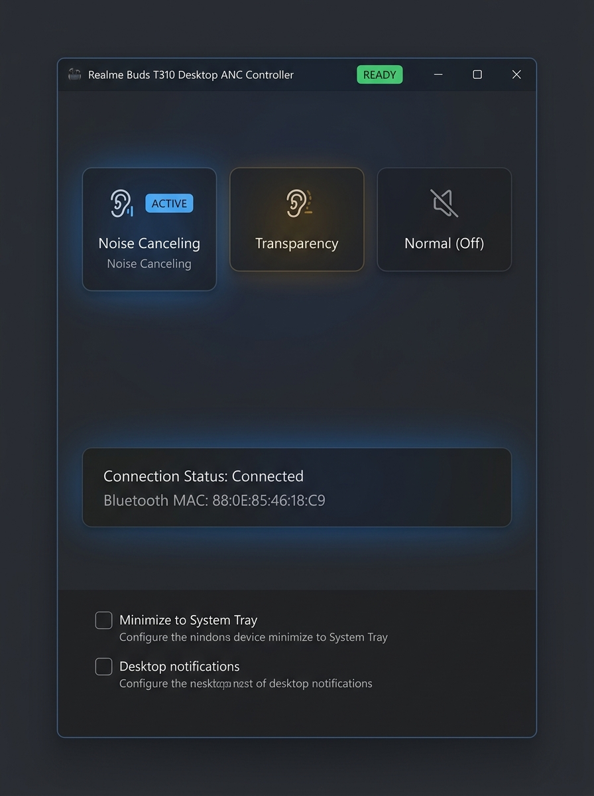

# Realme Buds T310 - Desktop ANC Controller & Protocol Reverse Engineering

<div align="center">

[](https://www.python.org/)
[](https://www.microsoft.com/windows)
[](https://github.com/krishvora445/realme-buds-desktop)
[](LICENSE)

**Native Windows desktop control and protocol reverse engineering for Realme Buds T310 wireless earbuds.**  
*Switch between Active Noise Cancellation, Transparency, and Normal (ANC Off) modes directly from your PC without touching your phone.*

<br/>



<br/><br/>

</div>

---

## 💡 The Story & Why We Built This

If you connect the **Realme Buds T310** to a Windows PC or Mac, you can listen to audio normally, but you lose granular hardware control. 
Crucially, Realme locked **"Normal Mode"** (both ANC Off and Transparency Off) strictly behind their mobile companion app (*realme Link*), preventing desktop users from toggling it via earbud gestures.

Instead of keeping a smartphone tethered just to toggle earbud modes while working, we reverse-engineered the communication channel between the companion app and the earbuds. This project delivers a standalone, elegant Windows 11 desktop app and CLI to control your earbuds natively.

> ### 🛡️ Responsible Interoperability Notice
> This project is **not** a hack, exploit, vulnerability, or DRM bypass. It does not tamper with firmware, crack encryption, or access cloud endpoints. It is an **interoperability research project** that recreates standard local Bluetooth RFCOMM control packets so users can manage hardware they already own from their desktop operating system.

---

## 🔬 How We Solved It (Reverse Engineering with REA)

Early attempts using raw `RMV` (`52 4D 56`) packets over standard RFCOMM sockets resulted in dropped connections and zero response from the earbuds.

To uncover why, we leveraged AI-assisted reverse-engineering workflows and investigated the decompiled Android companion APK (`com.realme.link`) alongside **[morluto/rea](https://github.com/morluto/rea)** (Reverse Engineer Anything):

1. **Protocol Identification**:
   - The earbuds do not use raw generic SPP. They implement the BBK/Oppo **OPOv1 proprietary framing protocol** starting with magic byte `0xAA`.
   - The primary command channel operates over custom RFCOMM service UUID:  
     `0000079A-D102-11E1-9B23-00025B00A5A5`
2. **The Missing Handshake Trap**:
   - The earbuds silently drop all mode change requests unless an initial **two-step authentication handshake** is performed:
     - **Step 1 (`HELLO`)**: `AA 07 00 00 00 01 23 00 00 12`
     - **Step 2 (`REGISTER`)**: `AA 0C 00 00 00 85 41 05 00 00 B5 50 A0 69` (containing ecosystem token `B5 50 A0 69`)
3. **Verified Mode Mapping**:
   Once authenticated, the earbuds immediately acknowledge and switch modes:
   - **Noise Canceling**: `AA 0A 00 00 04 04 40 03 00 01 01 04`
   - **Transparency**: `AA 0A 00 00 04 04 42 03 00 01 01 02`
   - **Normal (ANC Off)**: `AA 0A 00 00 04 04 42 03 00 01 01 01`

---

## ✨ Features

- **Windows 11 Fluent UI**: Dark mode card-based interface with accent colors for each active mode.
- **System Tray Integration**: Lives unobtrusively in your notification area next to the clock and Quick Settings with right-click quick toggles.
- **Non-Blocking Architecture**: Bluetooth connections and WinRT RFCOMM socket streaming run on background worker threads—your UI never lags or hangs.
- **Auto-Minimize**: Closing the window cleanly hides it in the tray.
- **Scriptable CLI**: Standalone command-line tool for scripting, hotkeys, and automated workflows.

---

## 🚀 Quick Start

### 1. Prerequisites
- Windows 10 or Windows 11
- Python 3.10+
- Your Realme Buds T310 paired to Windows via Bluetooth

### 2. Installation
```bash
git clone https://github.com/krishvora445/realme-buds-desktop.git
cd realme-buds-desktop
pip install -r requirements.txt
```

### 3. Launching the App
- **Standard UI**:
  ```bash
  python app.py
  ```
  *(Or double-click `run_app.bat`)*

- **Silent Background Tray (No Terminal Window)**:
  Double-click `run_silent.vbs` or execute:
  ```bash
  pythonw app.py
  ```

- **Desktop Shortcut**:
  Generate a Windows desktop shortcut with the official icon by running:
  ```bash
  python create_shortcut.py
  ```

---

## 🎛️ Command-Line Interface (CLI)

Prefer hotkeys or terminal commands? Use [realme_ctl.py](realme_ctl.py):

```bash
# Toggle Noise Canceling
python realme_ctl.py anc

# Toggle Transparency
python realme_ctl.py trans

# Toggle Normal Mode (ANC Off)
python realme_ctl.py normal

# Interactive terminal menu
python realme_ctl.py
```

---

## 📊 Protocol Specification Reference

### Frame Anatomy
```text
┌──────┬──────┬──────┬──────┬──────┬──────┬──────┬──────┬─────────────────┐
│ SOF  │ LEN  │ PAD  │ PAD  │ CAT  │ SUB  │ SEQ  │ FLAG │  PAYLOAD BYTES  │
│ 0xAA │ 0x.. │ 0x00 │ 0x00 │ 0x04 │ 0x04 │ 0x.. │ 0x.. │  ...            │
└──────┴──────┴──────┴──────┴──────┴──────┴──────┴──────┴─────────────────┘
```

| Parameter | Value | Description |
| :--- | :--- | :--- |
| **Service UUID** | `0000079A-D102-11E1-9B23-00025B00A5A5` | Custom OPO RFCOMM Command Channel |
| **Category (`CAT`)** | `0x04` | Audio / ANC Parameter Control |
| **Sub-Command (`SUB`)** | `0x04` | Set Parameter |
| **Auth Token** | `B5 50 A0 69` | Protocol registration token |

---

## 🤝 Contributing & Community
Contributions, bug reports, and pull requests to expand support for other Realme/Oppo/OnePlus earbud models are very welcome!

1. Fork the Project
2. Create your Feature Branch (`git checkout -b feature/AmazingFeature`)
3. Commit your Changes (`git commit -m 'Add some AmazingFeature'`)
4. Push to the Branch (`git push origin feature/AmazingFeature`)
5. Open a Pull Request

---

## 📜 License
Distributed under the MIT License. See `LICENSE` for more information.
